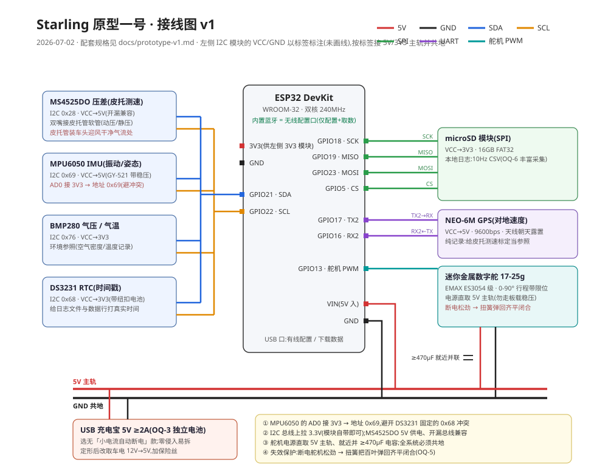

# Starling 原型一號規格(prototype v1)

> 2026-07-02 · 依據:charter §6 全部 OQ 裁決 + 本日硬體選型四拍板(見附錄 A 決策記錄)。
> **一句話**:一套臺架上就能跑起來的最小實物——對皮托管來風,百葉像鰓一樣張開;風停,彈簧把它合回齊平。

---

## 0. 目標與縱切片(第一週可觀察)

原型一號**不追求裝車**,追求"看得見地跑通全鏈":

```
迎面氣流 → 皮托管 → MS4525DO 壓差 → ESP32(門檻值-斜坡曲線) → 舵機 → 連桿 → 多片百葉張合
                                    ↘ 感測器套餐 → microSD 紀錄(純被動記錄)
                                    ↘ USB / 藍牙 → 設定與取數(不碰即時控制)
```

**成功判據(臺架)**:
1. 對皮托管吹氣(吹風機/騎車慢速手持),百葉隨"風速"張開;停風後回到齊平閉合;
2. 拔電源,葉片被扭簧彈回閉合(失效保護實測);
3. SD 卡裡有一段完整 CSV 紀錄(時間戳/壓差/速度/開度/IMU/GPS);
4. 手機藍牙或 USB 序列埠能改門檻值參數並保存,重新啟動後生效。

---

## 1. BOM 清單

| # | 類別 | 器件 | 關鍵規格 | 用途 | 參考價(¥) |
|---|---|---|---|---|---|
| 1 | 主控 | **ESP32 DevKit(WROOM-32)** | 雙核 240MHz·內建藍牙+WiFi·USB 序列埠 | 即時控制 + 設定口(藍牙免外掛,OQ-7) | 25 |
| 2 | 測速 | **MS4525DO 空速計模組 + 皮托管套裝** | 數位 I2C(0x28)·14 位·含皮托管與軟管 | 皮託壓差 → 速度(OQ-4) | 150~230 |
| 3 | 作動 | **17-25g 迷你金屬齒數位伺服馬達** | EMAX ES3054 級(17g/3.5kg·cm)或 JX 同級 | 單舵機連桿聯動全部葉片(1 自由度) | 30~60 |
| 4 | 資料 | MPU6050 模組(GY-521) | I2C **0x69(AD0→3V3)** | 振動 / 姿態記錄 | 6 |
| 5 | 資料 | BMP280 模組 | I2C 0x76·3V3 | 氣溫 / 氣壓(環境參照) | 5 |
| 6 | 資料 | DS3231 RTC 模組 | I2C 0x68·帶紐扣電池 | 紀錄真即時間戳 | 8 |
| 7 | 資料 | microSD SPI 模組 + 16GB 卡 | 3.3V 直連型·FAT32 | 本機紀錄(OQ-6) | 15 |
| 8 | 資料 | NEO-6M GPS 模組(GY-GPS6MV2) | UART 9600·含天線 | 對地速度/軌跡(皮託標定參照) | 25 |
| 9 | 供電 | USB 行動電源 5V ≥2A | **選無小電流自動斷電款** | 獨立電池·零侵入(OQ-3 階段一) | 已有/50 |
| 10 | 機構 | PETG/PLA 列印料 | PETG 優先(耐熱日曬) | 固定框 / 葉片 / 搖臂 | 已有 |
| 11 | 機構 | 扭簧(小規格若干試配) | 回位力矩 ≤0.5kg·cm 級 | 斷電彈回閉合(OQ-5) | 10 |
| 12 | 機構 | 連桿/銷軸五金 | 1.5~2mm 鋼絲拉桿·M2 螺絲·黃銅管軸套 | 葉片聯動 | 20 |
| 13 | 電氣雜項 | 杜邦線·XH2.54 接頭·熱縮管·≥470µF 電解電容·麵包板 | — | 串接 | 20 |
| | | | | **合計** | **約 320~480** |

後期裝車追加(本輪不買):12V→5V 降壓帶保險絲(取車電,OQ-3 階段二)。

> **採購執行版(2026-07-02 零烙鐵審核)**:[`res/prototype-v1-采购清单.xlsx`](../res/prototype-v1-采购清单.xlsx) —— 含全部輔材(線纜/膠槍/端子/軸材等 37 項)、數量與備件策略、淘寶搜尋詞、免焊要點;臺架頁必買合計約 ¥615(全部 ¥826)。關鍵增補:模組一律選**已焊排針**發貨、空速計套裝標配 **JST-GH 座須配轉杜邦線**、DS3231 須 **LIR2032 充電版**(CR2032 要拆電阻=焊接活)、新增 **ESP32 38Pin 端子擴充板**、機構聯動改 **M2 球頭拉桿+易拉夾**(免彎鋼絲)。**PCB 結論**:臺架階段不打板(全免焊可跑通);裝車階段做**模組底板**(嘉立創貼片+外掛焊,排母插模組),不做晶片級全集成(詳見 xlsx「說明與PCB方案」頁)。

---

## 2. 串接



| ESP32 引腳 | 接 | 說明 |
|---|---|---|
| GPIO21 / GPIO22 | I2C SDA / SCL | 匯流排掛 MS4525DO(0x28)、MPU6050(0x69)、BMP280(0x76)、DS3231(0x68) |
| GPIO18/19/23/5 | microSD SCK/MISO/MOSI/CS | VSPI |
| GPIO17 / GPIO16 | GPS RX / TX(交叉) | UART2,9600bps |
| GPIO13 | 舵機信號 | LEDC 50Hz PWM |
| VIN / GND | 5V 主軌 / 共地 | 行動電源 USB 剝線或用 USB 分線板 |

**四條硬注意**(接錯最常見的坑):
1. **MPU6050 的 AD0 必須接 3V3** → 位址變 0x69,否則與 DS3231 的固定位址 0x68 衝突,匯流排讀亂;
2. MS4525DO 用 5V 供電,I2C 開漏、匯流排上拉 3.3V(模組自帶上拉即可),與 ESP32 直連安全;
3. **舵機電源直取 5V 主軌**,不要走 ESP32 板載穩壓(堵轉瞬間電流會把主控拉復位),就近並 ≥470µF 電容;全系統共地;
4. 皮托管裝在**車頭迎風乾淨氣流處**(臺架階段手持即可),動壓/靜壓兩根軟管別接反(接反 = 讀數永遠為負,韌體會視為 0)。

---

## 3. 供電預算

| 負載 | 典型 | 峰值 |
|---|---|---|
| ESP32(藍牙開) | 120mA | 250mA |
| 舵機(17-25g 數字) | 10mA 靜置 | 600~800mA 堵轉瞬間 |
| GPS + 感測 + SD | 70mA | 120mA |
| **合計** | ~200mA | **<1.2A** |

5V/2A 行動電源裕量充足。**坑**:多數行動電源負載 <100mA 數分鐘後自動斷電——買標註"支援小電流/手環模式"的,或接一個小負載保活;斷電不危險(彈簧回閉合),但紀錄會斷。

---

## 4. 機構規格(3D 列印,下一步出 CAD)

- **固定框**:外框約 **120 × 70mm**、梯形/矩形 U 框(承全部風載),背面通透(charter §1③),框緣包住葉片邊緣防哨音;帶側板安裝耳。
- **葉片**:**4 片**,約 100 × 15mm,cambered 薄翼型截面(與 3D 演示一致),中軸銷轉動(威尼斯百葉式),兩端黃銅管軸套。
- **聯動**:每片葉帶同長曲柄,一根鋼絲拉桿串聯全部曲柄,舵機搖臂驅動拉桿 = **1 個真實自由度**(OQ-M)。
- **行程**:**0°(豎直齊平閉合)→ 90°(水平全開)**;兩端列印硬限位塊,韌體再疊軟限位(雙保險)。
- **失效保護**:扭簧裝在其中一片葉軸上、預緊朝閉合方向;舵機通電頂開、斷電鬆勁 → 彈簧帶動整組連桿回閉合。彈簧回位力矩 ≤0.5kg·cm(舵機 3.5kg·cm 裕量 7 倍;先買幾個小規格試配)。
- **材料**:臺架 PLA 快速迭代;裝車件換 **PETG**(耐熱日曬)。
- **風載參考**:100km/h 動壓 ~470Pa,4 片葉總受風面 ~0.006m² → 總力 ~3N,折算軸力矩 ~0.3kg·cm——舵機與簧都遠夠。

> **CAD 已完成實作(2026-07-02)**:參數化原始碼 [`cad/starling_v1.scad`](../cad/starling_v1.scad) + 6 件 STL([`cad/stl/`](../cad/stl))+ 繪製驗證圖([`cad/preview/`](../cad/preview));列印/下料/裝配/標定說明見 [`cad/README.md`](../cad/README.md)。注意兩處與上文的完成實作修正:**閉合角 = 10° 微傾**(純豎直相鄰葉尖干涉,鱗片式搭接;韌體標定 `us0` 自然吸收)、**內腔高 56→60**(葉尖掃掠間隙)。

---

<a id="5-固件設計骨架見-firmwarestarlingstarlingino"></a>

## 5. 韌體設計(骨架見 [`firmware/starling/starling.ino`](../firmware/starling/starling.ino))

**狀態機**:

```
BOOT(外設自檢) → ZERO_CAL(靜止 2s 壓差零偏校準) → RUN(50Hz 控制環)
                                                     ↕(感測連續失敗 25 次 / 恢復)
                                                    FAULT(舵機回 0° 閉合·繼續紀錄·週期重試)
```

**控制律(每 20ms)**:壓差 q(減零偏) → IAS = √(2q/1.225) → EMA 濾波 → **門檻值-斜坡曲線 + 滯回**(v>V_ON 才起開;回落到 V_ON−HYST 以下才歸零) → **限斜率**(SLEW°/s 防抖動) → **0~OPEN_MAX 硬限位** → 舵機脈寬。

**預設參數**(NVS 持久化,全部可經設定口改;數值待臺架/路測標定,OQ-5):

| 參數 | 預設 | 含義 |
|---|---|---|
| V_ON | 20 km/h | 開始張開門檻值 |
| V_FULL | 60 km/h | 全開速度 |
| HYST | 3 km/h | 關閉滯回 |
| OPEN_MAX | 90° | 全開角硬上限 |
| SLEW | 120°/s | 開度變化限斜率 |
| SERVO_US_0 / _90 | 1000/2000µs | 閉合/全開脈寬(裝配後標定) |
| LOG_HZ | 10 | 紀錄頻率 |

**紀錄**(microSD,CSV,10Hz):`ms, 日期时间(RTC), q_pa, ias_kmh, open_pct, servo_deg, ax/ay/az/gx/gy/gz, imu_temp, baro_pa, baro_temp, gps_fix/lat/lon/spd_kmh` —— 純被動記錄,不進控制閉環(OQ-6 邊界)。

**設定口**(USB 序列埠與藍牙 SPP 共用同一命令臺,115200):`help / stat / get / set k v / save / cal / log on|off / test <deg> / reboot`。
**§3 邊界鎖死**:`test`(手動擺舵)**僅在 IAS < 5km/h 時接受**(純臺架用途);無 OTA;藍牙僅設定+取數,任何"外部端即時控制開度"的功能一律不做。

---

## 6. 裝配與驗證步驟(按序,每步可觀察)

1. **麵包板電氣鏈**:ESP32 + MS4525DO,序列埠列印 q 與 IAS,對皮托管吹氣看數值 → 證測速鏈;
2. **加舵機**:吹氣 → 舵機擺角隨"風速"走曲線 → 證控制鏈(此時即是"翼面隨輸入張合"的最小縱切片);
3. **加齊感測套餐 + SD**:跑 10 分鐘拿到完整 CSV → 證資料鏈;藍牙/USB 改參數存取 → 證設定鏈;
4. **列印機構**:框+葉+連桿裝配,手推順滑無卡滯 → 掛舵機聯動 → 掛扭簧,斷電彈回實測;
5. **整機臺架**:吹風機全鏈演示(= §0 成功判據);
6. 之後才談裝車:側板安裝耳適配、皮託走線、封閉場地試跑(OQ-10)。

---

## 7. 安全與失效(呼應 OQ-5 / OQ-10)

- 斷電/韌體跑飛 → 舵機鬆勁 → 扭簧彈回齊平閉合(靜止態 = 最低阻、最低姿態);
- 機械硬限位 + 韌體軟限位雙保險,葉片永不越 0~90° 行程;
- 無尖銳外緣,框緣包葉;裝車階段按 OQ-10 做當地車檢自查與封閉場地驗證。

---

## 附錄 A · 硬體選型決策記錄(2026-07-02,老方式一輪拍板)

| 議題 | 我的推薦 | owner 拍板 | 備註 |
|---|---|---|---|
| 主控 MCU | ESP32 DevKit | **ESP32 DevKit** ✓ | 內建藍牙滿足 OQ-7 免外掛 |
| 壓差感測 | MPXV7002DP 模擬(便宜夠用) | **MS4525DO 數位 I2C** ✗推薦被否 | owner 選數字件:免 ADC 噪聲、低速端更穩(門檻值點 ~20km/h 僅 ~19Pa) |
| 舵機 | MG90S → 追問中間檔後薦 MG92B | **17-25g 迷你金屬數位伺服馬達** | owner 主動要中間檔(EMAX ES3054 級),買摩托振動環境耐久裕量 |
| 資料套餐 | 標準包(IMU+氣壓+RTC+SD) | **標準包 + GPS** | GPS 對地速度給皮託標定當參照,契合 OQ-6 R&D 資料集 |
